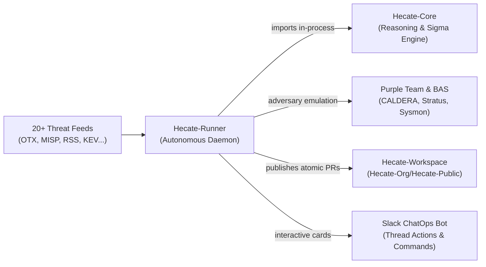

# Hecate-Runner

> **The Autonomous Threat Hunting & Detection Engineering Daemon.**
> Continuous 24/7 CTI intake, dual-track scheduling, adversary emulation, automated rule tuning, and PR publishing.

[](https://www.python.org/downloads/)
[](https://opensource.org/licenses/MIT)
[](systemd/hecate-runner-daemon.service)
[](src/hecate_runner/cti)

---

## 🧭 Overview

**Hecate-Runner** (`hecate_runner`) is the autonomous driver of the Hecate platform. Operating as a perpetual daemon service, it continuously monitors threat intelligence feeds, triages and dedupes incoming advisories, executes purple-team adversary emulation, synthesizes detection logic through [Hecate-Core](https://github.com/Hecate-Org/Hecate-Core), and opens pull requests into [Hecate-Workspace](https://github.com/Hecate-Org/Hecate-Public).

> [!TIP]
> **New to Hecate-Runner?** Check out the [Onboarding Guide](docs/ONBOARDING.md) for a step-by-step walkthrough of local setup, adversary emulation, and daily workflows.

It enforces strict operational guardrails:
- **Zero-Unattended Production Execution:** Detections are drafted in `status: planning` requiring human approval.
- **Dual-Track Scheduling:** High-velocity indicator feeds use fast deterministic sweeps; narrative reports receive deep agentic research.
- **Automated Self-Remediation:** Detection rules failing syntax, logsource, or platform tests are automatically remediated before saving.
- **Durable Outbox:** Atomic writes and SQLite outboxes guarantee no duplicate drafts or leaked quotas across system reboots.

---

## 🏛 Ecosystem Architecture



- **[Hecate-Core](https://github.com/Hecate-Org/Hecate-Core)**: Sibling library providing the LLM agents, ATT&CK STIX matrix, Sigma drafting, and pySigma transpilers.
- **[Hecate-Runner](https://github.com/Hecate-Org/Hecate-Runner)** *(this repo)*: Autonomous perpetual daemon, multi-feed CTI triage, purple-team emulation, and Slack bot.
- **[Hecate-Workspace](https://github.com/Hecate-Org/Hecate-Public)**: Version-controlled detection repository holding hunts (`hunts/`), queries (`queries/`), research dossiers (`research/`), and promotion gates.

---

## 📂 File & Directory Structure

```text
Hecate-Runner/
├── src/hecate_runner/           # Primary Python package
│   ├── bas/                     # Breach & Attack Simulation (CALDERA, Stratus, Mock, Verifier)
│   ├── correlation.py           # Campaign clustering & incremental hunt updater
│   ├── cti/                     # 20+ CTI feed providers (OTX, MISP, RSS, KEV, AnyRun...)
│   ├── orchestrator.py          # Central autonomous worker loop & queue manager
│   ├── purple_team.py           # Adversary emulation & synthetic telemetry replay
│   ├── rule_tuner.py            # Automated reviewer self-remediation feedback loop
│   ├── indicator_sweep.py       # Zero-token deterministic sweep engine
│   ├── github_publisher.py      # Durable SQLite outbox & GitHub PR publisher
│   ├── slack_bot.py             # Interactive Slack Bot with Block Kit UI
│   ├── hunt_writer.py           # Atomic LOCK markdown and Sigma YAML writer
│   ├── config.py                # Environment and quota configuration
│   └── cli.py                   # Typer CLI entrypoint (`hecate-runner`)
├── systemd/                     # Systemd service unit files
│   ├── hecate-runner-daemon.service    # Resident event-driven worker daemon
│   └── hecate-runner-slack-bot.service  # Interactive Slack bot service
├── docs/                        # Complete technical documentation
│   ├── ONBOARDING.md            # Step-by-step developer onboarding guide
│   ├── ARCHITECTURE.md          # 3-repo architecture blueprint & data flow
│   ├── FEATURES.md              # Exhaustive feature matrix and subsystem details
│   ├── BAS_SAFETY_AUDIT.md      # Safety guarantees & lab isolation boundaries
│   ├── CHALLENGES.md            # Technical challenges solved (hallucinations, token quotas)
│   └── HOW_TO.md                # Developer recipes & step-by-step guides
├── scripts/                     # Operational scripts (systemd installer, lab setup)
└── tests/                       # 1,100+ unit and integration tests
```

---

## 🚀 5-Minute Quick Install & Getting Started

### Prerequisites
- Python 3.11+
- [uv](https://docs.astral.sh/uv/) (`curl -LsSf https://astral.sh/uv/install.sh | sh`)
- An LLM API key (Anthropic, OpenAI, AWS Bedrock) or a local [Ollama](https://ollama.com) instance

### Step 1: Clone Repositories Side-by-Side
```bash
mkdir -p ~/betas && cd ~/betas

git clone https://github.com/Hecate-Org/Hecate-Core.git
git clone https://github.com/Hecate-Org/Hecate-Runner.git
git clone https://github.com/Hecate-Org/Hecate-Public.git Hecate-Workspace
```

### Step 2: Install Dependencies with `uv`
```bash
# Install Hecate-Runner (automatically links sibling ../Hecate-Core in-process)
cd ~/betas/Hecate-Runner
uv sync --all-extras
```

### Step 3: Configure Environment
Copy `.env.example` into `Hecate-Workspace/.env` (Runner automatically symlinks to it):
```bash
cd ~/betas/Hecate-Workspace
cp .env.example .env
```

Ensure your configuration includes your API keys and quotas:
```dotenv
# Threat Intelligence Feeds
OTX_API_KEY=...
MISP_BASE_URL=https://misp.example.com
MISP_API_KEY=...
MISP_OUTPUT_API_KEY=...             # optional dedicated writer credential
HECATE_RUNNER_MISP_PUBLISHING_ENABLED=true

# Model & Search API
HECATE_AI_PROVIDER=anthropic      # or openai, bedrock, ollama
ANTHROPIC_API_KEY=sk-ant-...
TAVILY_API_KEY=tvly-...

# Autonomous Scheduler & Quotas
HECATE_RUNNER_SOURCES=multi       # polls all configured feeds
HECATE_RUNNER_MAX_DRAFTS_PER_DAY=12
HECATE_RUNNER_SWEEP_COOLDOWN_SECONDS=30
HECATE_RUNNER_DEEP_COOLDOWN_SECONDS=180

# GitHub Publishing (Optional PR integration)
HECATE_RUNNER_GITHUB_PUBLISHING_ENABLED=true
HECATE_RUNNER_GITHUB_APP_ID=...
HECATE_RUNNER_GITHUB_INSTALLATION_ID=...
HECATE_RUNNER_GITHUB_APP_PRIVATE_KEY_PATH=/run/secrets/hecate-publisher.pem
HECATE_RUNNER_GITHUB_PUBLISHING_REPOSITORY=Hecate-Org/Hecate-Public
```

### Step 4: Run a Test Hunt or Launch the Daemon

GitHub publication defaults to a private target. A public destination requires
`target_visibility: public` in its promotion policy, `risk.tlp_amber: block`, and
no `allow_private` risk actions. Explicitly allowing unmarked source material
uses `risk.unknown_tlp: allow`. Restricted TLP markings and credentials are
checked before the first public GitHub write, including on retries.

To retain local hunt history while changing the remote destination, set
`HECATE_RUNNER_GITHUB_PUBLISHING_REPOSITORY` to the new repository,
`HECATE_RUNNER_GITHUB_PUBLISHING_POLICY_PATH` to its local policy file, and
`HECATE_RUNNER_GITHUB_PUBLISHING_OUTBOX_PATH` to a fresh queue database. This
keeps previous queued exports separate. Install the publisher App on the new
repository and enable its promotion workflow, required checks, and auto-merge
before switching the service configuration.

MISP output is independent of the MISP intake source. After the final hunt and
Sigma steps, the Runner queues the hunt, linked research, and detection files in
a durable local outbox. Each hunt has one organization-only, unpublished MISP
event, with readable reports and file attachments. Typed indicators retain their
provenance and have `to_ids=false` pending review. Retries reconcile stable UUIDs
and verify the stored content; an unavailable MISP does not cause a hunt to be
drafted again. Hecate-generated events are excluded from MISP intake.

```bash
hecate-runner misp enable          # requires MISP_BASE_URL and a writer API key
hecate-runner misp publish H-0911  # explicitly export an existing hunt
hecate-runner misp sync            # retry due exports without running a hunt
hecate-runner misp status --json   # confirmed event IDs and pending failures
hecate-runner sources disable opencti
```

```bash
# Option A: Draft a hunt immediately from raw CTI text
uv run hecate-runner draft \
  --title "Test Adversary Activity" \
  --content "Adversaries executed powershell -enc with beaconing to 198.51.100.5"

# Option B: Run a single cycle against active feeds
uv run hecate-runner run

# Option C: Start the autonomous resident daemon in the foreground
uv run hecate-runner daemon --interval 60
```

---

## ⚙️ Operating the Autonomous Daemon

### Running via Systemd (Recommended for Production)

Hecate-Runner includes a production-grade systemd service unit:

```bash
# Install user systemd service
./scripts/install-systemd.sh

# Start daemon
systemctl --user start hecate-runner-daemon.service

# Inspect live status
systemctl --user status hecate-runner-daemon.service

# View streaming journal logs
journalctl --user -u hecate-runner-daemon.service -f
```

### Running Interactively in Foreground
For local development, testing, or debugging:

```bash
# Run daemon continuously with a 60-second polling interval
uv run hecate-runner daemon --interval 60

# Run a single cycle against active feeds
uv run hecate-runner run

# Run a single cycle against a specific feed
uv run hecate-runner run --source cisa_kev
uv run hecate-runner run --source otx
```

### On-Demand Manual Drafting
Draft a hunt immediately from custom threat intelligence text:

```bash
uv run hecate-runner draft \
  --title "Akira Ransomware PerfLogs Staging" \
  --content "Adversaries deployed gost tunnel and rclone into C:\PerfLogs\ to exfiltrate data..." \
  --source-url "https://news.sophos.com/akira-perflogs"
```

### Live Adversary Emulation & Breach Simulation (BAS)

For unattended operation restricted to reviewed Linux lab procedures and real
local process observation, see [approved BAS automation](docs/BAS_AUTOMATION.md).
Execute on-demand adversary emulation or run closed-loop detection verification across Linux, Windows, or Cloud:

```bash
# Live Linux detonation via CALDERA on local agent
uv run hecate-runner bas-detonate T1033 --provider caldera --host hecate-bas-lab --platform linux --env lab

# Windows detonation with automatic Mock fallback (when no active Windows agent is connected)
uv run hecate-runner bas-detonate T1059.001 --provider caldera --host lab-win10 --platform windows --env lab

# Cloud adversary emulation via Stratus Red Team (AWS / GCP / Azure)
uv run hecate-runner bas-detonate T1562.008 --provider stratus --platform aws --env staging --account-id 123456789012

# Run closed-loop detection verification against a hunt draft and update frontmatter
uv run hecate-runner bas-verify H-0804 --provider caldera --host lab-win10 --env lab --write-back
```

---

## 💬 ChatOps & Slack Bot

Launch the interactive Slack Bot to receive real-time notifications with interactive review actions:

```bash
# Run Slack Bot
uv run hecate-runner slack-bot
```

- **Interactive Cards:** Every drafted hunt sends a Block Kit card with title, hypothesis summary, ATT&CK techniques, and candidate Sigma rules.
- **One-Click Actions:** Security engineers can trigger validation replays or request AI rule tuning directly from Slack threads.
- **Slash Commands:** Use `/hecate status`, `/hecate hunt <ID>`, or `/hecate promote <ID>`.

---

## 🧪 Testing & Verification

The entire 850+ test suite runs offline with complete mocks:

```bash
# Run full test suite
uv run pytest -q

# Run specific subsystem tests
uv run pytest tests/test_purple_team_pipeline.py
uv run pytest tests/test_cti_multi.py
uv run pytest tests/test_daemon.py
```

---

## 📚 Complete Documentation

- **[System Architecture](docs/ARCHITECTURE.md)**: Three-repository design, lifecycle diagrams, and agent graphs.
- **[Feature Reference](docs/FEATURES.md)**: Exhaustive breakdown of ingestion, dual-track scheduling, and evaluation.
- **[Engineering Challenges](docs/CHALLENGES.md)**: Deep dive into hallucination defense, token economics, and telemetry synthesis.
- **[Developer How-To Guides](docs/HOW_TO.md)**: Step-by-step recipes for adding CTI feeds, SIEM targets, and local evals.

---

## 📄 License

MIT License. See [LICENSE](LICENSE) for details.


## Structured CTI sources and confirmed health

Enable sources with `hecate-runner sources enable <name>`. Public repository
sources use `GITHUB_TOKEN` when configured for higher API rate limits. They poll
hourly, compare immutable blob revisions, and queue changed entries durably.
First use establishes a baseline; it does not backfill the entire catalog. An
acknowledgment consumes one entry, while fetch/schema/rate-limit failures retain
pending work. At most ten filtered entries are examined per poll.

| Provider | Intake and enrichment |
| --- | --- |
| `lolbas` | Changed [LOLBAS](https://github.com/LOLBAS-Project/LOLBAS) YAML procedures, including exact decoded command strings and ATT&CK IDs; named binary enrichment. |
| `loldrivers` | Changed [LOLDrivers](https://github.com/magicsword-io/LOLDrivers) entries and vulnerable sample hashes; hash lookup against the official JSON API with a daily cache and snapshot digest. |
| `gtfobins` | Changed [GTFOBins](https://github.com/GTFOBins/GTFOBins.github.io) YAML entries (including extensionless files), function commands and privilege contexts; named binary enrichment. |
| `nuclei` | Changed HTTP CVE [templates](https://github.com/projectdiscovery/nuclei-templates), in priority tier 1 beside KEV. Requires live KEV membership or FIRST EPSS at the configured `HECATE_RUNNER_FIRST_ORG_MIN_EPSS` and `HECATE_RUNNER_FIRST_ORG_MIN_PERCENTILE` thresholds (defaults 0.5 and 0.85). Embedded template EPSS scores do not authorize intake. FIRST scores older than three days, malformed responses and API outages defer processing. |
| `cisa_advisories` | Dedicated [CISA advisory feed](https://www.cisa.gov/cybersecurity-advisories/all.xml) with a browser user agent and full article retrieval for narrative AA/CSA reports; independent official [CISA CSAF IT](https://github.com/cisagov/CSAF) deltas. A failed narrative channel remains red even when CSAF works. |
| `cisa_ics` | Official CISA CSAF OT advisories, preserving notes, CVEs, versions and original documents. Legacy TLP:WHITE maps explicitly to TLP:CLEAR. |
| `attack_deltas` | Monthly commit-pinned [MITRE ATT&CK STIX](https://github.com/mitre-attack/attack-stix-data) enterprise and ICS deltas. Changed techniques and procedure examples become deep-track items only for techniques without a non-archived hunt. Timestamp/version-only changes and revoked/deprecated objects are ignored; pending items are checked again against current coverage. |

Catalogs, Nuclei and ATT&CK deltas use the deep research route. Catalog and template
examples are reference capabilities, never claims of an observed intrusion.
Their domains and placeholders are excluded from incident IOC extraction and
secondary OSINT queries. Catalog enrichments remain background context, separate
from primary incident evidence; disable them with
`HECATE_RUNNER_CATALOG_ENRICHMENT_ENABLED=false`.

Structured primary sources retain exact source text and revision. Catalog command
values produce deterministic reference candidates only when they include a
specific argument. Nuclei retains method, path, headers, body, raw requests,
extractors and response matchers separately. Concrete request methods/URIs produce
Sigma candidates and source-based replay events without inferred methods or
invented matcher values. Template DSL, variables, scanner callbacks and fetched
commands are never executed. Unresolved paths, request bodies and custom headers
remain in the source for analyst mapping; they are not silently translated into
unavailable web-log fields. HTTP KQL requires a real deployed table mapping;
unsupported target conversions retain explicit rejection reasons.

`hecate-runner sources check` performs read-only connectivity/schema checks and
writes local health records under `.hecate/integrations/`; it neither advances CTI
cursors nor creates hunts. The daemon refreshes these checks hourly in a background
thread. The monitor shows **green only for enabled integrations confirmed within
the past two hours**. Failed, disabled, unconfigured, stale and unconfirmed
integrations are **red**, and disabled integrations remain visible in the grid.
CISA narrative and CSAF health are shown separately. An unconfigured OpenCTI
instance is unconfirmed, even though the existing provider has a test-data fallback.

Intentionally filtered Nuclei entries retain the last 200 decisions, with reasons
and pinned source revisions, in `.hecate/source-decisions/nuclei.json`. Cursors,
health records and catalog caches are runtime state, not content to commit.
`hecate-runner sources reset <name>` resets delta sources to a fresh baseline on
their next poll. Restart the daemon and reopen the monitor after installing an
update so both processes load the new code and configuration.

## Reviewed community releases

Use `hecate-runner release build` for the explicit original-content catalog and
`release verify` for its existing isolated BAS controls. Public hunt snapshots
now remain private in `awaiting_review` until `publish-review` records an exact
privacy/redistribution approval; the separate GitHub quality gate still applies.
See [the community release guide](docs/COMMUNITY_RELEASES.md). Private MISP output
keeps its organization-only, unpublished, non-IDS defaults.
