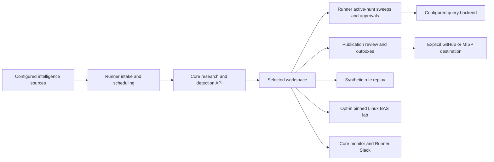

# Hecate system architecture

Core supplies the functional engine; Runner coordinates work. The selected
workspace supplies enterprise knowledge and stores content/results. Public is a
shared catalog and starter workspace. `.github` supplies organization docs.

## Code and state boundaries

| Component | Owns |
| --- | --- |
| [Core](https://github.com/Hecate-Org/Hecate-Core) | Agents, grounding, Sigma/transpilation, workspace readers, CLI, monitor |
| [Runner](../src/hecate_runner/) | Intake, quotas, scheduling, approvals, providers, BAS, notification/publication |
| [Public](https://github.com/Hecate-Org/Hecate-Public) | Shareable hunts, research, query artifacts and starter knowledge |
| Selected private workspace | Enterprise environment contract, guidance, `.env`, findings, execution ledger and `.hecate/` state |

A shared interpreter is needed for Runner's in-process Core integration. Export
`HECATE_WORKSPACE` before invoking either application. Existing environment
variables and a cwd `.env` can override selected-workspace dotenv values. Neither
installation nor repository adjacency automatically creates a symlink or merges
knowledge from another workspace.

## Independent operating paths

1. Existing-hunt sweeps read active hunt/query content and execute configured
   backend queries under count-first gates and approval policy. New CTI research
   and H-file generation are not required. Optional findings/pivots can use models.
2. CTI generation polls configured sources, triages/deduplicates content, reserves
   quotas, gathers evidence/research, proposes hypotheses and writes planning hunts
   and candidate detections. Reference-only sources remain capability references.
3. Maintenance retries publication jobs, runs configured drift audits and dispatches
   reminders independently of generation. An outbox retry does not redraft a hunt.
4. Slack Socket Mode handles interactive actions. A foreground Core monitor reads
   workspace evidence and metrics; it is not an execution service.

The generation implementation is split across `orchestrator_intake.py`,
`orchestrator_grounding.py`, `orchestrator_rules.py`,
`orchestrator_validation.py` and `orchestrator_publishing.py`. Review and
conversion results can be reused when their exact inputs match; source-backed
checks still apply after reuse.

## Evidence boundaries

| Outcome | What is established |
| --- | --- |
| Synthetic replay / `simulation_match` | The evaluator matched synthetic samples; no command executed |
| `simulation_no_match` / unsupported simulation | Offline samples did not match or cannot evaluate that query |
| `smoke_check_match` | Limited lab behavior matched; attack technique coverage remains unverified |
| Local sensor + Sigma | Independently observed scoped lab events matched the actual rule |
| `query_match` | A native search returned matches; it is not an alert firing |
| SIEM alert proof | A correlated fired-alert record and that alert job's marked results establish the specific run |

The unattended lab path permits only pinned reviewed Linux procedures and checks
isolation, allowlists, rule compatibility, independent observations and cleanup.
A technique tag alone grants no execution or validation credit. Mock fallback is
opt-in; disable it when live-unavailable cases must fail or skip. Windows/cloud
execution and arbitrary Atomic command execution are not implied.

Replay holdouts are synthetic and cannot estimate production false-positive
rates. Local BAS and replay scorecards stay separate. See [BAS automation](BAS_AUTOMATION.md)
for procedure fidelity, shared execution locks, quarantine and fired-alert proof.

## Publication and operations

GitHub publishing needs an explicit destination and approved policy. A public PR
already exposes content, so exact-snapshot privacy/redistribution review precedes
upload. Promotion/content checks do not deploy a production alert. MISP's private,
unpublished outbox path is independent of feed intake. See [community releases](COMMUNITY_RELEASES.md).

The daemon/maintenance templates are system services; Slack and the prepared
Sandcat supervisor use user services. Adapt deployment-specific templates first.
Application logs may be file-backed rather than in the journal. Secrets, private
run JSON, traces and local databases remain outside public Git. Restart services
and reopen monitors after updating their code or environment.
