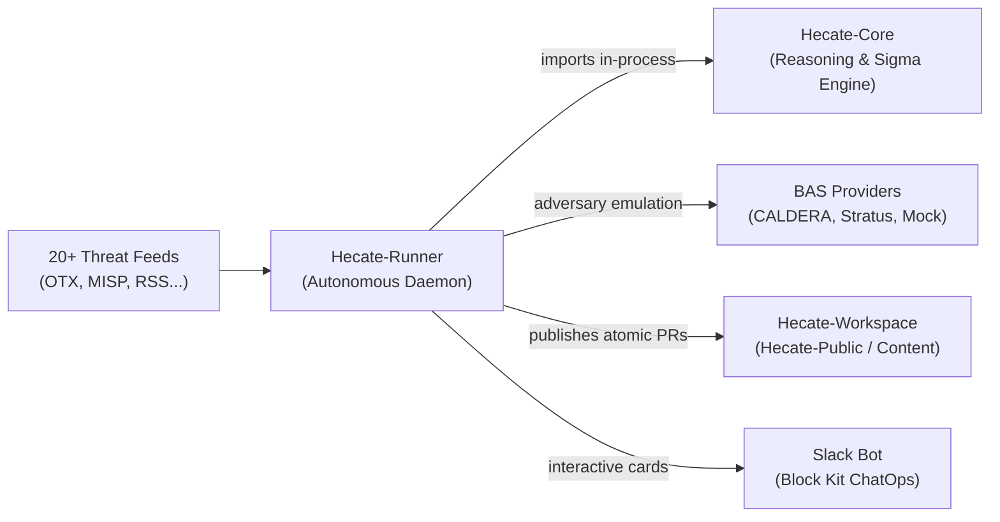

# Onboarding: Getting Started with Hecate-Runner

> **Welcome to Hecate-Runner!** This guide walks you through setting up the autonomous threat hunting daemon, understanding how it interacts with sibling repositories, and running your first automated hunt and adversary emulation locally.

---

## 🧭 What is Hecate-Runner?

**Hecate-Runner** (`hecate_runner`) is the autonomous operational engine of the Hecate threat hunting ecosystem. Operating either as a resident daemon (`systemd`) or an on-demand CLI tool, it continuously:

1. **Ingests Threat Intelligence**: Polls 20+ feeds (CISA KEV, AlienVault OTX, MISP, RSS, ThreatFox, MalwareBazaar, VulnCheck, etc.).
2. **Triages & Clusters Campaigns**: Filters low-signal noise, clusters threat entities (CVEs, threat actor aliases, shared C2 IOCs) into existing hunt dossiers, or passes novel threats for hunting.
3. **Drafts Detections via Hecate-Core**: In-process integration with `hecate_agent` to draft behavioral hypotheses, ATT&CK TTPs, and candidate Sigma rules.
4. **Validates via Breach & Attack Simulation (BAS)**: Executes adversary emulation in isolated lab environments (via CALDERA, Stratus Red Team, or Mock providers) and verifies telemetry detection.
5. **Autonomously Publishes PRs**: Commits drafted hunts into [Hecate-Workspace](https://github.com/Hecate-Org/Hecate-Public) as pull requests in `status: planning` for human review.

---

## 🏛 The 3-Repo Architecture

Hecate is designed to run with three repositories checked out side-by-side in a common root directory (e.g. `~/betas`):



| Repository | Canonical URL | Role |
| :--- | :--- | :--- |
| **[`Hecate-Core`](https://github.com/Hecate-Org/Hecate-Core)** | `github.com/Hecate-Org/Hecate-Core` | Core reasoning library, ATT&CK knowledge graph, Sigma generator, and pySigma transpilers. |
| **[`Hecate-Runner`](https://github.com/Hecate-Org/Hecate-Runner)** | `github.com/Hecate-Org/Hecate-Runner` | Autonomous daemon, CTI intake, BAS adversary emulation, campaign clustering, and PR publishing. *(this repo)* |
| **[`Hecate-Public`](https://github.com/Hecate-Org/Hecate-Public)** | `github.com/Hecate-Org/Hecate-Public` | Content catalog holding hunts (`hunts/`), queries (`queries/`), research briefs (`research/`), and promotion policy. |

---

## 🚀 5-Minute Quick Setup

### 1. Prerequisites
- Python 3.11+
- [uv](https://docs.astral.sh/uv/) (recommended package and venv manager)
  ```bash
  curl -LsSf https://astral.sh/uv/install.sh | sh
  ```
- Git

### 2. Clone Repositories Side-by-Side
```bash
mkdir -p ~/betas && cd ~/betas

git clone https://github.com/Hecate-Org/Hecate-Core.git
git clone https://github.com/Hecate-Org/Hecate-Runner.git
git clone https://github.com/Hecate-Org/Hecate-Public.git Hecate-Workspace
```

### 3. Install Dependencies
`Hecate-Runner` automatically links sibling `../Hecate-Core` as an editable workspace dependency:
```bash
cd ~/betas/Hecate-Runner
uv sync --all-extras
```

### 4. Configure Environment
Copy the configuration template into your workspace:
```bash
cd ~/betas/Hecate-Workspace
cp .env.example .env
```
Ensure `Hecate-Runner/.env` symlinks to `Hecate-Workspace/.env` (or configure your keys directly):
```dotenv
# --- LLM Reasoning Provider ---
HECATE_AI_PROVIDER=anthropic      # options: anthropic, openai, bedrock, ollama
ANTHROPIC_API_KEY=sk-ant-...
TAVILY_API_KEY=tvly-...          # For grounded web research

# --- Threat Intelligence Feeds (Optional) ---
OTX_API_KEY=...
MISP_BASE_URL=https://misp.example.com
MISP_API_KEY=...

# --- BAS Adversary Emulation (Optional) ---
HECATE_BAS_ENABLED=true
HECATE_BAS_PROVIDER=mock          # options: mock, caldera, stratus
```

---

## 🛠 Everyday Developer Commands

All CLI commands run through `uv run hecate-runner <command>`:

### 1. Draft a Hunt Immediately (Manual CTI)
To test the complete reasoning and Sigma generation pipeline without waiting for live feeds:
```bash
uv run hecate-runner draft \
  --title "Akira Ransomware PerfLogs Staging" \
  --content "Adversaries deployed gost tunnel and rclone into C:\PerfLogs\ to exfiltrate sensitive data." \
  --source-url "https://news.sophos.com/akira-perflogs"
```

### 2. Run a Single Intake Cycle
Poll active feeds and process at most one actionable hunt:
```bash
# Run against all configured feeds
uv run hecate-runner run

# Run against a specific feed
uv run hecate-runner run --source cisa_kev
uv run hecate-runner run --source otx
```

### 3. Adversary Emulation & Breach Simulation (BAS)
Detonate TTPs in controlled environments or test closed-loop rule verification:
```bash
# Detonate a technique via Mock provider (instant, safe, zero-risk)
uv run hecate-runner bas-detonate T1033 --provider mock --platform linux --env lab

# Detonate via CALDERA on a designated lab host
uv run hecate-runner bas-detonate T1059.001 --provider caldera --host hecate-bas-lab --platform linux --env lab

# Run closed-loop detection verification against an existing hunt draft
uv run hecate-runner bas-verify H-0001 --provider mock --env lab --write-back
```

### 4. Cross-Source Campaign Clustering
Enable clustering to incrementally enrich active hunts rather than creating duplicate drafts:
```bash
export HECATE_CAMPAIGN_CLUSTERING_ENABLED=true
uv run hecate-runner run
```

### 5. Running the Autonomous Daemon
Run the perpetual scheduler with 60-second polling:
```bash
# Foreground execution (press Ctrl+C to stop)
uv run hecate-runner daemon --interval 60

# Production systemd background service
./scripts/install-systemd.sh
systemctl --user start hecate-runner-daemon.service
journalctl --user -u hecate-runner-daemon.service -f
```

---

## 🧪 Testing & Code Quality

Hecate-Runner maintains an extensive automated test suite with over 1,100 tests.

```bash
# Run all unit and integration tests
uv run pytest

# Run specific subsystem tests
uv run pytest tests/test_correlation.py     # Campaign clustering
uv run pytest tests/test_bas_*.py          # BAS & Caldera automation
uv run pytest tests/test_orchestrator.py   # Main orchestrator pipeline

# Code formatting and linting
uv run ruff check
uv run ruff format --check

# Static type checking
uv run mypy src/hecate_runner
```

---

## 📂 Source Code Walkthrough

```text
src/hecate_runner/
├── bas/                         # Breach & Attack Simulation subsystem
│   ├── caldera.py               # CALDERA REST API integration & operation lifecycle
│   ├── stratus.py               # Stratus Red Team cloud detonation
│   ├── mock.py                  # Zero-infrastructure test provider
│   ├── verifier.py              # Closed-loop detection verifier
│   └── approved.py              # Safety policy, allowlists, and host boundaries
├── cti/                         # Threat intelligence feed collectors
│   ├── abuse_ch.py, cisa_kev.py, otx_poller.py, misp_poller.py, rss.py...
├── correlation.py               # Threat entity correlation & incremental hunt enrichment
├── orchestrator.py              # Core autonomous pipeline loop and intake queue
├── hunt_writer.py               # Atomic LOCK markdown and Sigma rule writer
├── rule_tuner.py                # Automated detection reviewer and self-healing loop
├── github_publisher.py          # SQLite outbox and GitHub pull request creator
├── misp_publisher.py            # MISP event and attribute publisher
├── slack_bot.py                 # Block Kit Slack ChatOps bot
└── config.py                    # Environment, quotas, and security configuration
```

---

## 🤝 Getting Help & Contributing
- For core reasoning engine docs, see [`Hecate-Core/docs/`](https://github.com/Hecate-Org/Hecate-Core/tree/main/docs).
- For end-to-end architecture diagrams, see [`docs/ARCHITECTURE.md`](ARCHITECTURE.md).
- For safety guidelines and isolation guarantees, see [`docs/BAS_SAFETY_AUDIT.md`](BAS_SAFETY_AUDIT.md).
